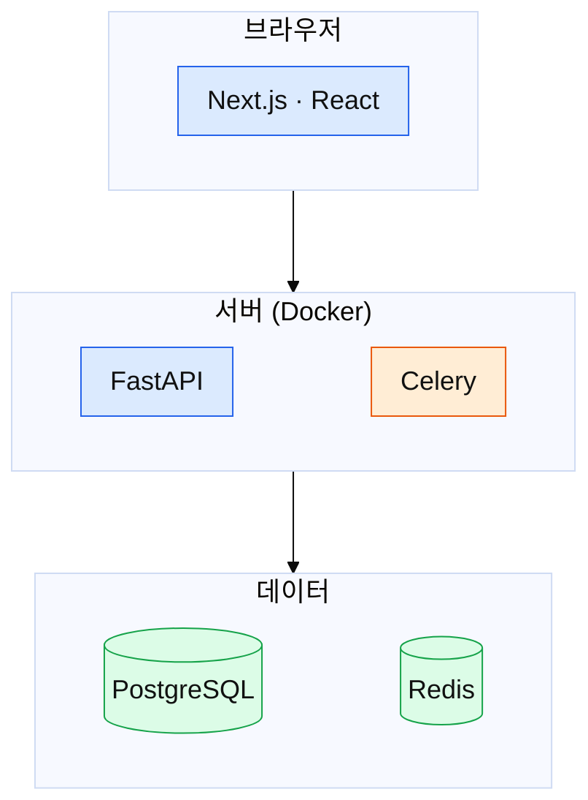
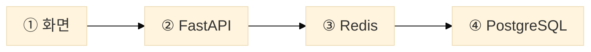

# 기술 스택 설명 / 技術スタックの説明

기술 스택을 설명할 때는 사용자가 따로 요청하지 않아도 **① 구성도 → ② 기술별 역할 표 → ③ 연동 흐름** 세 부분을 이 순서로 만든다. 독자가 그림 한 장으로 전체를 보고, 표로 이름마다 하는 일을 확인하고, 흐름도로 기술끼리 무엇을 주고받는지 따라가게 하는 것이 목표다.

## 1. 언제 적용하는가

아래 중 하나에 해당하면 적용한다.

- 기술명세서·기술 사양서·技術仕様書를 쓴다 (`design` 템플릿).
- 설계서·조사자료·사용자설명서가 시스템을 이루는 기술(언어·프레임워크·라이브러리·DB·외부 서비스·인프라)을 **3개 이상** 다룬다.
- 세션 설명을 `detailed`로 하면서 기술 스택·아키텍처·"이 프로젝트가 무엇으로 만들어졌는지"를 설명한다.

적용하지 않는 경우
- 기술 하나만 설명한다 (그 기술의 개념 설명으로 충분하다).
- 검토자료에서 기술 후보를 비교한다 (그건 「선택지 비교」 표의 일이다). 단, 추천안을 넣은 뒤의 구성을 보여 줄 때는 적용한다.
- 윤문 모드. 원문에 없는 관계(화살표)를 새로 만들게 되므로 그림을 직접 넣지 않는다. 원문에 기술이 3개 이상 나오면 결과 보고에 "구성도·역할 표·연동 흐름을 추가할 수 있음" 한 줄을 제안으로 붙인다.

## 2. 사실을 어디서 가져오는가 (불변식)

- 기술 이름·버전·이 프로젝트에서의 용도·파일 경로는 **재료에서만** 가져온다: 사용자 자료, 의존성 파일(`package.json`, `pyproject.toml`, `requirements.txt`, `go.mod`, `Cargo.toml`, `*.csproj`, `pom.xml`, `build.gradle`), `Dockerfile`·`docker-compose.yml`, 진입점·설정 파일, 실제 코드.
- 저장소가 있으면 쓰기 전에 위 파일을 읽어 확인한다. 의존성에는 있는데 용도를 코드에서 확인하지 못하면 표에 `[확인 필요: {이름}의 용도]` / `【要確認：{名前}の用途】`로 둔다.
- 프로젝트 `CLAUDE.md`·기존 설계 문서와 코드가 다르면 **코드와 의존성 파일이 이긴다.** 다른 곳은 「결정 필요」(문서를 고칠지 코드를 고칠지)나 `[확인 필요]`로 드러낸다.
- 기술의 일반적인 역할("three.js = 3D 엔진", "Redis = 메모리 저장소")은 일반 지식이라 써도 된다. "이 프로젝트에서 무엇에 쓰는가"는 재료로 확인한 것만 쓴다.
- 코드 발췌는 실제 파일에서 글자 그대로 가져오고, 생략한 곳은 `// …` 주석으로 표시하고, 파일 경로를 붙인다.

## 3. 세 부분의 규칙

섹션 맨 앞에 1~2문장으로 이 섹션에서 무엇을 보게 되는지 쓴다 (예: "이 시스템은 세 층으로 나뉘고, 요청 1건은 다섯 단계를 거칩니다").

### ① 구성도 — 한눈에 보기

- **층으로 쌓는다.** 위 = 사용자에 가까운 층(화면·API 입구), 아래 = 실행 환경(런타임·DB·OS·GPU 등). 바깥 틀은 실행 환경의 경계(브라우저, 서버, 컨테이너, 클라우드 계정)이고 틀 이름을 적는다.
- **상자에 넣는 정보**: HTML(SVG)은 최대 3줄(① 기술 이름 ② 독자 말로 쓴 한 줄 역할 ③ 있으면 코드 위치나 대표 예). Mermaid는 기술 이름 한 줄만 넣고, 역할·위치는 그림 바로 아래 목록과 ② 표로 뺀다 (6절).
- **화살표 뜻은 하나만**: "위가 아래를 쓴다/부른다". 데이터 흐름은 ③에서 그린다. 두 뜻을 한 그림에 섞지 않는다.
- **색은 역할 묶음 3~5개**(예: 화면 줄기 · 데이터 · 상태 · 외부 서비스 · 개발 도구). 그림 아래에 색 범례를 한 줄로 쓴다. 색만으로 구분하지 않고 이름·위치로도 알 수 있게 한다.
- 실행 환경 밖 도구(제품이 돌 때 함께 돌지 않는 빌드·테스트·배포·변환 도구)는 그림 바닥에 한 줄로 따로 모은다. 개발 모드에서만 실행 환경 안에서 도는 도구(디버그 패널 등)는 그림 안에 두고 "(개발 모드만)"을 붙인다.
- 상자는 12개 이하. 넘으면 같은 역할끼리 한 상자로 묶는다 (예: "leva · r3f-perf").

### ② 기술별 역할 표

| 이름 | 한 줄 역할 | 없으면? |
|---|---|---|

- 행 순서는 구성도의 위 → 아래, 왼쪽 → 오른쪽 순서와 같게 한다. 구성도의 상자는 모두 표에 있다.
- 「한 줄 역할」은 이 프로젝트에서 맡은 일을 독자 말로 쓴다. 전문 용어는 처음 나올 때 괄호로 푼다 (독자 규칙을 따른다).
- 「없으면?」은 그 기술이 왜 필요한지를 체감하게 하는 칸이다: 없을 때 직접 해야 하는 일, 생기는 문제, 더 가벼운 대안이 있으면 그것. `normal`에서는 생략할 수 있고 `detailed`에서는 넣는다.
- 버전이 재료에 있고 의미가 있으면(메이저 버전 차이로 동작이 다를 때) 이름 옆에 쓴다.

### ③ 연동 흐름 — 기술끼리 무엇을 주고받는가

- **대표 동작 하나**를 고른다: 요청 1건, 화면 1프레임, 배치 1회, 버튼 클릭 1번처럼 시스템이 가장 자주 또는 가장 중요하게 반복하는 일.
- 그 동작을 **번호 단계(①②③…)**로 그린다. 단계마다: 단계 이름 / 무엇을 하는지 / 맡은 기술·파일. 반복되는 동작이면 마지막 단계에서 처음으로 돌아가는 점선 화살표와 주기(예: "약 16.7 ms 뒤")를 단다. 주기가 둘 이상이면(렌더는 가변, 물리는 1/60초 고정 등) 각 단계 옆에 따로 적는다.
- 그림 아래 문단에 **순서가 왜 이런지**를 쓴다. 순서가 바뀌면 생기는 문제, 시간·빈도 제약(60fps, 타임아웃, 처리량)을 재료에 있는 만큼.
- `detailed`에서는 이어서 **연동을 지키는 설계 규칙 2~4개**를 `### 규칙 N. {규칙 한 문장}` 형식으로 쓴다. 각 규칙: 왜 필요한지 1문단 → 실제 코드 발췌 → 발췌를 읽는 법 1~2줄.

### ④ (선택) 폴더 지도

저장소가 있고 `detailed`이면 `| 폴더 | 들어 있는 것 |` 표를 덧붙인다. 구성도의 상자가 어느 폴더에 있는지 독자가 찾아갈 수 있게 하는 것이 목적이다.

## 4. 상세도별 분량

| 단계 | 넣는 것 |
|---|---|
| `short` | ② 표만 (이름 · 한 줄 역할). 그림 없음 |
| `normal` | ① 구성도 + ② 표 + ③ 흐름도와 순서 이유 1문단 |
| `detailed` | `normal` + ② 「없으면?」 칸 + ③ 설계 규칙과 코드 발췌 + ④ 폴더 지도 |

## 5. 문서 종류별 위치

| 종류 | 위치 |
|---|---|
| 설계서·기술명세서 (`design`) | 「상세」의 첫 소절 `### 기술 스택과 연동`. ① 구성도가 템플릿의 「구성도」를 대신하고, 「인터페이스」「데이터 구조」 등 나머지 소절은 템플릿의 상세도 기준대로 그 뒤에 이어 쓴다 |
| 조사자료 (`research`) | 「상세」 안. 조사한 대상의 구성을 설명할 때 |
| 사용자설명서 (`manual`) | 「알아 둘 것」 또는 별도 "전체 그림" 문서. 절차 사이에 넣지 않는다 (Diátaxis) |
| 세션 설명 (`detailed`) | 결론 1~2줄 뒤에 ①②③ 순서 |

## 6. 출력 형식 — 먼저 정하고 만든다

Markdown(Mermaid)과 HTML(SVG)은 표현력이 다르므로, **그리기 전에 형식을 정한다.** 정하는 순서:

1. 사용자가 형식을 말했거나, 고치려는 파일이 이미 있으면 그 형식.
2. 프로젝트에 **같은 주제를 그림으로 설명한 문서**(기술 스택·아키텍처·구성 설명. 문서 종류 이름은 따지지 않는다)가 있으면 그 형식. 다이어그램 스타일(CSS 클래스, 공용 SVG 부품, Mermaid 스타일 규약 문서)이 있으면 그것을 따르고, 이 파일의 Mermaid 규칙보다 앞세운다. 그런 문서가 형식별로 섞여 있으면 새 문서가 놓일 폴더의 형식을 따른다.
3. 세션 설명이면 Mermaid.
4. 그래도 정해지지 않으면 **쓰기 전에 한 번 묻는다.** 아래 기준으로 하나를 추천하고 이유를 한 줄 붙인다. 답을 받으면 이 세션에서는 다시 묻지 않는다.

상자 수는 그리기 전에 ② 역할 표의 초안(의존성 파일에서 뽑은 기술 목록을 묶은 것)의 행 수로 어림한다. 그래서 순서는 **재료 확인 → 역할 표 초안 → 형식 결정 → 그림**이다.

| 기준 | Markdown + Mermaid | HTML + 인라인 SVG |
|---|---|---|
| 층 배치 | 자동 배치라 층·정렬이 흐트러질 수 있다 | 좌표로 정확히 맞춘다 |
| 상자 안 정보 | 이름 한 줄. 여러 줄은 상자만 커지고 읽기 쉬워지지 않아 설명은 그림 밖으로 뺀다 | 이름·역할·코드 위치 3줄과 범례를 넣기 쉽다 |
| 크기 | 기본값은 화면 폭에 맞춰 줄어들어 글자가 작아진다. init 헤더로 막으면 대신 가로 스크롤이 생긴다 | 폭에 맞춰 줄고, 좁으면 가로 스크롤 |
| 라이트·다크 모드 | 색이 고정돼 한쪽에서 읽기 어려울 수 있다 | CSS 변수로 양쪽 대응 |
| 보는 곳 | GitHub·VS Code·Obsidian 등 렌더러가 있어야 그림으로 보인다 | 브라우저만 있으면 된다 |
| 수정·리뷰 | 텍스트라 diff·리뷰가 쉽고 고치기 싸다 | 좌표를 다시 계산해야 해서 고치기 비싸다 |

위에서부터 처음 맞는 것을 추천한다.
1. 독자가 `stakeholder`·`end-user`이거나 저장소 밖으로 배포·공유한다 → **HTML**.
2. 상자가 8개 이상이라 층 구조가 그림의 핵심이다 → **HTML**. 단, 독자가 `team`·`self`이면 "Markdown 본문 + 구성도만 SVG 파일로 따로 만들어 이미지로 넣기"를 함께 제시한다.
3. 그 밖 (`team`·`self`, 저장소 안에서 코드와 함께 고쳐 나가는 문서) → **Markdown**.

### Markdown 문서·세션 설명 → Mermaid

구성도는 `flowchart TB` + 층마다 `subgraph`, 연동은 번호를 붙인 단계. 프로젝트에 Mermaid 스타일 규약이 있으면 그것이 먼저다. 없으면 아래를 따른다 (렌더링해 확인한 것).

**크기와 글자**
- 블록 첫 줄에 init 헤더를 둔다. 기본값(`useMaxWidth: true`)은 그림을 문서 폭에 맞춰 줄여서 상자가 많을수록 글자가 작아진다. `theme`은 `base`로 한다 (다른 테마에서는 `themeVariables` 일부가 무시된다).
  ```
  %%{init: {'theme':'base','themeVariables':{'fontSize':'18px'},'flowchart':{'useMaxWidth':false,'nodeSpacing':55,'rankSpacing':70,'padding':10}}}%%
  ```
  `sequenceDiagram`은 `'sequence':{'useMaxWidth':false}`로 같은 일을 한다. 줄이지 않는 대신 좁은 화면에서는 가로 스크롤이 생긴다. 작아서 못 읽는 것보다 낫다.
- 라벨은 기술 이름 한 줄, 15자 안팎으로 쓴다. `<br/>`로 여러 줄을 넣지 않는다. 역할·설정값·파일 경로는 그림 바로 아래 목록으로 뺀다.
- 한 그림에 상자 12개 이하, `subgraph` 중첩은 2단까지. 넘으면 관심사별로 그림을 나눈다.

**층 배치**
- 층마다 `subgraph`를 위 → 아래로 선언하고, 층 사이 화살표는 **subgraph끼리** 잇는다 (`L1 --> L2`). 상자에서 다른 층 상자로 화살표를 그으면 그 subgraph의 `direction` 지정이 무시된다.
- 같은 층 상자는 **보이지 않는 연결 `~~~`로 이어야** 가로로 나란히 놓인다 (`A ~~~ B ~~~ C`). 층 안에 `direction LR`만 주면 연결 없는 상자는 오히려 세로로 쌓인다.
- 어느 상자가 무엇을 부르는지는 그림 아래 목록에 적는다. 같은 층 안 화살표는 그어도 된다.
- 표 순서는 subgraph 선언 순서, 그 안에서는 `~~~` 순서에 맞춘다.

**연동 흐름**
- 단계가 3~4개 직렬이면 `flowchart LR`. 그보다 많으면 단계가 많은 축을 세로로 둔다: 바깥은 `flowchart LR`, 단계 묶음(예: 수집 / 표시)마다 `subgraph` + `direction TB`로 사슬을 세로로 잇고, 묶음 사이 화살표는 subgraph끼리 잇는다.
- 단계마다 하는 일과 맡은 파일은 그림 아래에 단계 번호(①②…)를 붙인 목록으로 쓴다.
- 구성 요소 3개 이상이 요청·응답을 주고받는 연동이면 `sequenceDiagram`이 더 읽기 쉽다.

렌더링되지 않는 것이 확실한 곳(터미널 전용 출력)에서는 같은 구조를 들여쓰기 텍스트 트리로 쓴다.

예시 (가상의 사내 웹 서비스):

````markdown


- Next.js · React: 화면과 화면 주소 (`src/app`)
- FastAPI: 요청을 받아 검증·처리. PostgreSQL과 Redis를 쓴다
- Celery: 오래 걸리는 작업을 뒤에서 처리. Redis를 작업 대기열로 쓴다
- 색: 파랑 = 요청을 처리하는 줄기 · 초록 = 데이터 · 주황 = 백그라운드 작업. 바깥 도구: pytest(테스트) · GitHub Actions(배포)



- ① 화면: 버튼을 누르면 API를 부른다
- ② FastAPI: 입력을 검증한다
- ③ Redis: 캐시에 있으면 바로 응답한다
- ④ PostgreSQL: 없으면 조회하고 결과를 캐시에 넣는다
````

### HTML 문서 → 인라인 SVG

- `<div class="diagram" role="img" aria-label="{그림 전체를 한 문장으로}">` 안에 `<svg viewBox="0 0 900 H">`를 둔다. 폭 900 기준, 상자는 `rect rx="12"`, 층 사이 간격 18 정도.
- 글자는 클래스 세 가지: 제목(굵게), 역할(보통), 코드 위치(고정폭·작게). 색은 클래스(`dg-box`, `dg-acc` 등)로 주고 CSS 변수로 정의해 라이트·다크 모드에서 모두 읽히게 한다. SVG 안에 색 값을 직접 쓰지 않는다.
- 화살표는 `<marker>` 하나를 정의해 재사용한다. 그림마다 marker `id`를 다르게 한다 (한 페이지에 그림이 둘이면 충돌한다).
- 표는 `<div class="table-wrap"><table>`로 감싸 좁은 화면에서 가로로 스크롤되게 한다.

```html
<div class="diagram" role="img" aria-label="구성도: 브라우저 안에 화면 층, 그 아래 서버 API, 그 아래 데이터베이스가 있다">
<svg viewBox="0 0 900 300" xmlns="http://www.w3.org/2000/svg">
  <defs><marker id="ar-stack" viewBox="0 0 10 10" refX="9" refY="5" markerWidth="7" markerHeight="7" orient="auto-start-reverse"><path d="M0,0 L10,5 L0,10 z" class="dg-arrow"/></marker></defs>
  <rect x="8" y="8" width="884" height="250" rx="16" class="dg-frame"/>
  <text x="26" y="34" class="dg-s">{실행 환경 경계 이름}</text>
  <rect x="26" y="48" width="848" height="62" rx="12" class="dg-acc"/>
  <text x="44" y="74" class="dg-t">{기술 이름}</text>
  <text x="44" y="96" class="dg-s">{한 줄 역할}</text>
  <!-- 층을 아래로 반복. 화살표: <path d="M450 110 V128" class="dg-line" marker-end="url(#ar-stack)"/> -->
  <text x="26" y="288" class="dg-m">색: {색} = {역할 묶음} · …</text>
</svg>
</div>
```

## 7. 자기 점검

- [ ] 형식(Markdown/HTML)을 6절 순서로 정했고, 정해지지 않았을 때는 추천과 함께 물었다.
- [ ] ①②③이 이 순서로 있다 (상세도별 분량 기준).
- [ ] 구성도의 상자가 모두 역할 표에 있고, 표 순서가 그림 순서와 같다.
- [ ] 구성도의 화살표는 "쓴다/부른다" 한 뜻이고, 데이터 흐름은 연동 흐름도에만 있다.
- [ ] 연동 흐름도가 대표 동작 하나를 번호 단계로 따라가고, 순서의 이유가 그림 아래에 있다.
- [ ] 기술 이름·버전·용도·경로·코드 발췌가 모두 재료에서 확인된다. 확인하지 못한 것은 `[확인 필요]`다.
- [ ] 색 범례가 있고, 색 없이도 구분된다.
- [ ] Mermaid: init 헤더가 있고, 라벨이 한 줄이며, 상자별 설명이 그림 아래 목록에 있다.
